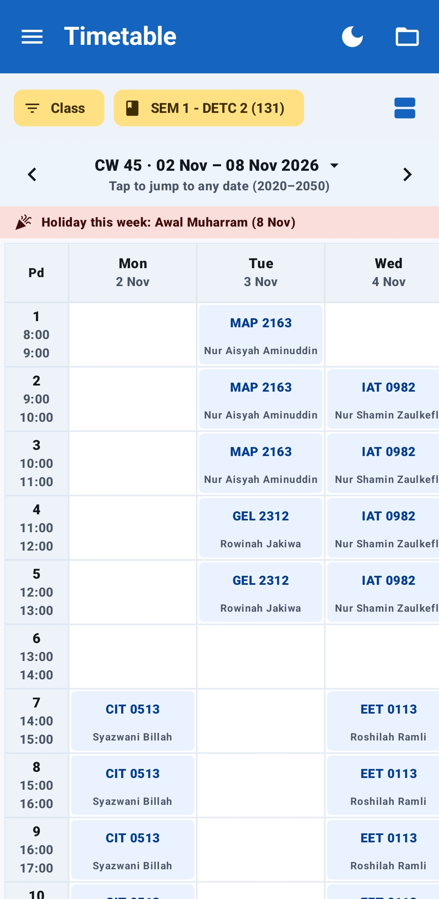

# Davinci

### Official GMI Timetable Companion for Android

Fast, modern, offline-first timetable viewer built for students, lecturers, and academic staff of **German-Malaysian Institute (GMI)**.

 

---

## Screenshots

| Splash Screen (AMOLED) | Welcome (AMOLED Dark) | Welcome (Light Mode) |
| :---: | :---: | :---: |
|  |  |  |

| Timetable — Card View | Timetable — Grid View |
| :---: | :---: |
|  |  |

---

## Key Features

- **1-Tap Official GMI Timetable Sync**
- **Local `.DAV` & `.DAVZ` Support**
- **Card View & Grid View**
- **Smart Calendar & Breaks**
- **Interactive Day / Night GMi Icon**
- **Adaptive 120Hz / 90Hz / 60Hz Display**
- **Pure `#000000` AMOLED Dark & Clean Light Modes**
- **Automatic In-App Updates**

---

## Installation Guide

1. Go to the **[Latest Release](https://github.com/Gffxt/davinci-releases/releases/latest)** page and download **`Davinci-v4.0.0-release.apk`**.
2. Tap the downloaded APK on your Android device (if prompted by Android or Play Protect for sideloaded apps, tap **More details → Install anyway**).
3. Launch **Davinci**, sign in once with your Google account, and tap **Sync Official GMI Timetable** (or upload your own `.dav` / `.davz` file).
4. Pick **My Saved Class** — Davinci remembers your class and opens straight to **Today** every time!

---

  Made by student · German-Malaysian Institute (GMI) · Maintained by <b>Gffxt</b>

