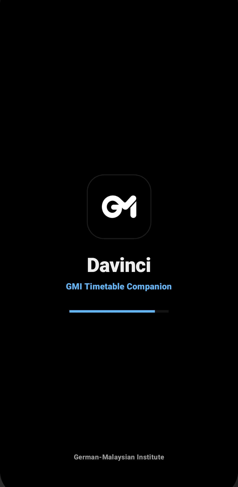
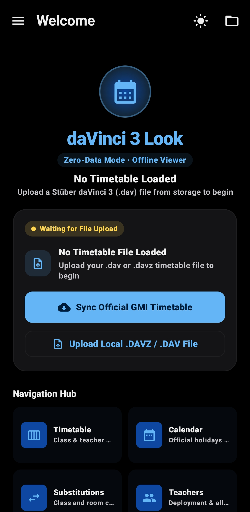
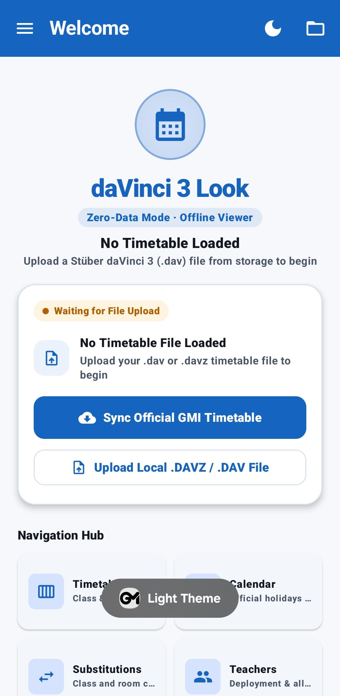
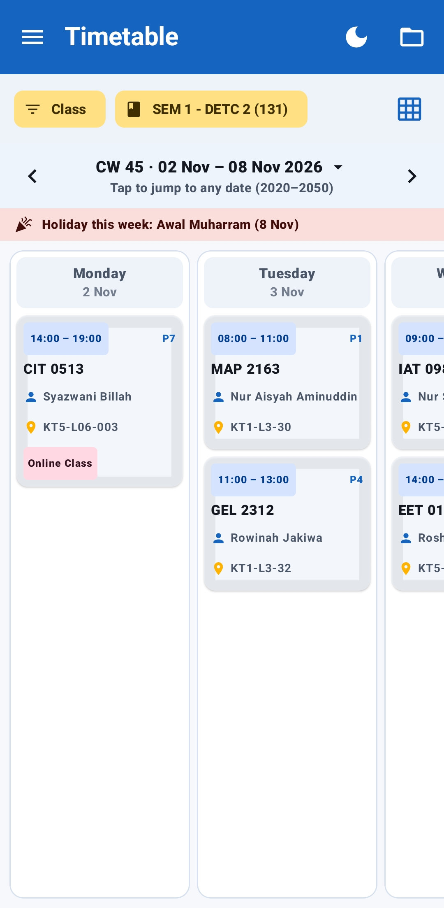

# Davinci

### Official GMI Timetable Companion for Android

Fast, modern, offline-first timetable viewer built for students, lecturers, and academic staff of **German-Malaysian Institute (GMI)**.

 

---

## Screenshots

| Splash Screen (AMOLED) | Welcome (AMOLED Dark) | Welcome (Light Mode) |
| :---: | :---: | :---: |
|  |  |  |

| Timetable — Card View | Timetable — Grid View |
| :---: | :---: |
|  |  |

---

## Key Features

- **1-Tap Official GMI Timetable Sync**: Sign in once with Google and sync the latest official GMI schedule directly inside the app — cached locally for **100% offline** viewing afterwards.
- **Local `.DAV` & `.DAVZ` Support**: Pure-Kotlin native Stüber daVinci V30 binary decoder (~200 ms decode time, zero WebView overhead).
- **Card View & Grid View**: Switch smoothly between modern scrollable day cards (auto-scrolling straight to **Today**) and a full period-by-period weekly grid.
- **Smart Calendar & Breaks**: Automatically highlights public holidays and semester breaks (e.g., *Semester Break*, *MID SEM BREAK*) and clearly marks unlisted weeks as *"Not Listed Yet by TTO's"*.
- **Interactive Day / Night GMi Icon**: Automatically switches between **Morning White (`06:00–18:59`)** and **Night AMOLED Black (`19:00–05:59`)**, with manual override in Settings.
- **Adaptive 120Hz / 90Hz / 60Hz Display**: Automatically matches your phone's native refresh rate for ultra-smooth scrolling.
- **Pure `#000000` AMOLED Dark & Clean Light Modes**: Instant theme toggle in the top bar and Settings.
- **Automatic In-App Updates**: Built-in SHA-256 verified update downloader so you always stay on the latest release.

---

## Installation Guide

1. Go to the **[Latest Release](https://github.com/Gffxt/davinci-releases/releases/latest)** page and download **`Davinci-v4.0.0-release.apk`**.
2. Tap the downloaded APK on your Android device (if prompted by Android or Play Protect for sideloaded apps, tap **More details → Install anyway**).
3. Launch **Davinci**, sign in once with your Google account, and tap **Sync Official GMI Timetable** (or upload your own `.dav` / `.davz` file).
4. Pick **My Saved Class** — Davinci remembers your class and opens straight to **Today** every time!

---

## Verification

All official APKs in this repository are signed with the same permanent **Davinci GMI** release certificate (APK Signature Scheme **v2 & v3**), allowing seamless in-place updates without losing your saved class or timetable:

- **Package ID**: `com.stueber.davinci3look`
- **Signing Certificate SHA-256**: `17:62:86:E4:9E:49:82:83:CF:6A:00:9F:42:E6:9A:72:30:B1:5A:6B:F4:01:6C:66:06:59:D6:55:49:AA:46:DE`
- **Latest APK (`v4.0.0`) SHA-256**: `5c3888d98685fc7f737fbf9c51a771aaa0b8c2be6d39856f2362762ff3f245b4`

---

  Made by student · German-Malaysian Institute (GMI) · Maintained by <b>Gffxt</b>

